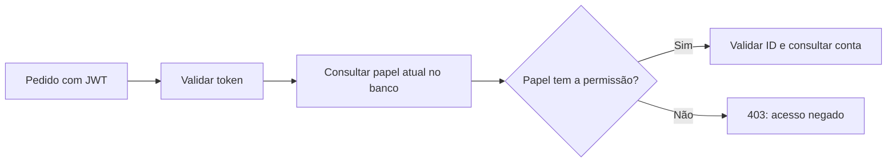

<!-- Documento: docs/13-controle-de-acesso-com-rbac.md -->

# 13 · Controle de acesso por tipo de usuário com RBAC

[← Anterior](12-guia-pratico-de-typescript.md) · [Índice](../README.md) · **Etapa 13 de 14** · [Próxima →](14-front-end-react-rbac.md)

**Ponto de partida:** use a API reconstruída pelos capítulos 1 a 11, com as versões fixadas no README. O capítulo 12 ajuda a entender os tipos usados aqui. O código existente em `src/` deste repositório pode ter modelos adicionais. Todos os caminhos abaixo partem da raiz da API, onde fica `package.json`. Crie as subpastas indicadas quando necessário. Os blocos `bat` são comandos para **CMD**, uma linha por vez; no PowerShell use `npm.cmd` e `npx.cmd`.

## Resultado desta etapa

Teremos uma tabela de usuários (modelo `User`) e outra de tipos de usuário (`tipo_usuario`). Cada conta terá um tipo: `ALUNO` ou `ADMIN`. O administrador poderá **listar todos os usuários** e **consultar qualquer conta** em rotas administrativas. As respostas públicas de usuário (`/login`, `/users`, `/admin/users`) passarão a informar o tipo e papel (`userTypeId` e `role: 'ALUNO' | 'ADMIN'`), permitindo que aplicações front-end (como no [capítulo 14](14-front-end-react-rbac.md)) controlem telas, navegação e botões conforme o perfil autenticado. As rotas pessoais continuarão permitindo alterações e exclusões somente na própria conta.

| Pedido | Sem login | ALUNO | ADMIN |
|---|---|---|---|
| `POST /users`, `POST /login` | Permitido (retorna `user.role`) | Permitido | Permitido |
| `GET /users` | 401 | Só a própria conta (com `role`) | Só a própria conta (com `role`) |
| `GET`, `PUT`, `DELETE /users/:id` | 401 | Só a própria conta | Só a própria conta |
| `GET /admin/users` | 401 | 403 | Lista todas as contas cadastradas |
| `GET /admin/users/:id` | 401 | 403 | Consulta a conta indicada |
| Escolher perfil no cadastro HTTP | Campo extra: 400 | Campo extra: 400 | Campo extra: 400 |

Validação, limites, cookies, proteção de origem e ocultação de senha dos capítulos anteriores continuam valendo. Os contatos `Cliente` mantêm a política do capítulo 10; o novo RBAC protege a rota administrativa acima.

## 1. Entender autenticação, papel e permissão

**Propósito do passo:** separar as perguntas que precisamos responder antes de permitir uma operação.

| Conceito | Pergunta | Exemplo |
|---|---|---|
| Autenticação | Quem está fazendo o pedido? | O JWT identifica a conta 10 |
| Papel / perfil / tipo | Qual função essa conta exerce? | A conta 10 é ADMIN |
| Permissão | Qual ação esse papel permite? | `users:read:any` permite consultar outras contas |
| Propriedade | Essa conta é dona deste registro? | A conta 10 pode editar `/users/10` |

**RBAC** significa *Role-Based Access Control*: controle de acesso baseado em papéis. Pense em uma escola: estudantes consultam sua própria conta; a administração consulta o cadastro de um estudante para prestar suporte. O nome do papel precisa ser associado a permissões e conferido pelo backend.

Não basta esconder um botão no frontend: alguém pode chamar a API por `curl.exe`. Também não podemos aceitar que o próprio cadastro escolha quem será administrador.



Aplicaremos **menor privilégio**: novos cadastros começam como alunos. E **negação por padrão**: papéis desconhecidos ou sem permissão não acessam a operação administrativa. A regra de proprietário do capítulo 5 continua necessária mesmo com RBAC.

## 2. Criar a relação entre as tabelas

**Propósito do passo:** ligar cada usuário a um tipo sem perder contas já cadastradas.

Exemplo de dados depois da preparação:

| `tipo_usuario.id` | `code` | `name` |
|---|---|---|
| 1 | ALUNO | Estudante |
| 2 | ADMIN | Administração |

| `User.id` (exemplo) | `email` | `userTypeId` |
|---|---|---|
| 10 | ana@example.com | 1 |
| 20 | bruno@example.com | 2 |

`userTypeId` guarda o ID do tipo. Vários usuários apontam para um mesmo tipo: relação **um para muitos**. `code` é um identificador estável para o código; `name` é um rótulo legível. Os IDs 1 e 2 são reservados para esse catálogo, não para contas de pessoas.

Pare o servidor com Ctrl+C e confira o banco de **desenvolvimento** em `.env`. Faremos duas migrações: primeiro o vínculo opcional, depois o preenchimento das contas antigas e o vínculo obrigatório. Não reinicie o servidor entre as fases.

**Arquivo: `src/prisma/contract.prisma`**

Substitua todo o conteúdo na API do guia. Se você acrescentou outros modelos, preserve-os; não remova nem renomeie tabelas existentes para adaptar este exemplo.

<!-- file: src/prisma/contract.prisma -->
```prisma
// use prisma-8
// Arquivo: src/prisma/contract.prisma

model User {
  id         Int       @id @default(autoincrement())
  email      String    @unique
  name       String?
  password   String
  createdAt  DateTime  @default(now())
  userTypeId Int?
  userType   UserType? @relation(fields: [userTypeId], references: [id], onDelete: Restrict)

  @@index([userTypeId])
}

model UserType {
  id    Int    @id
  code  String @unique
  name  String
  users User[]

  @@map("tipo_usuario")
}

model Cliente {
  id        Int      @id @default(autoincrement())
  name      String
  email     String   @unique
  createdAt DateTime @default(now())
}
```

`@@map` dá à tabela o nome físico `tipo_usuario`; o TypeScript usa `UserType`. No contrato deste guia, o Prisma 8 gera a tabela física `user` para o modelo `User`; a coluna `userTypeId` mantém esse nome. As tabelas didáticas acima usam os nomes do código. Confira os nomes físicos no plano gerado; preservamos a tabela de usuários anterior. A chave estrangeira criada por `@relation` impede referências a tipos inexistentes. `Restrict` impede excluir tipos ainda usados; `@@index` cria um índice no vínculo. O `?` permite ausência de tipo temporariamente.

```bat
npm run contract:emit
npx prisma migration plan --name rbac_tipo_opcional
```

Revise o plano em `migrations/app/`: deve acrescentar a tabela, coluna opcional, índice e chave estrangeira. Não deve apagar contas nem recriar `User` ou `Cliente`. Se isso aparecer, pare e confira a referência de migração, como no capítulo 2.

```bat
npx prisma db migrate --advance-ref db
npx prisma db verify
```

## 3. Preparar os tipos e preencher contas antigas

**Propósito do passo:** criar o catálogo e atribuir o menor privilégio às contas sem tipo.

**Arquivo: `src/scripts/init-rbac.ts`**

Crie este arquivo e copie todo o conteúdo. O script reutiliza tipos existentes e preenche apenas contas sem tipo. Ele pode ser executado novamente; não execute duas cópias em paralelo.

<!-- file: src/scripts/init-rbac.ts -->
```typescript
// Arquivo: src/scripts/init-rbac.ts
import { db } from '../prisma/db.js';

try {
  const types = [
    { id: 1, code: 'ALUNO', name: 'Estudante' },
    { id: 2, code: 'ADMIN', name: 'Administração' },
  ];
  for (const type of types) {
    const byId = await db.orm.public.UserType.first({ id: type.id });
    const byCode = await db.orm.public.UserType.first({ code: type.code });
    if ((byId && byId.code !== type.code) || (byCode && byCode.id !== type.id)) {
      throw new Error('Catálogo de tipos conflitante. Revise os IDs antes de continuar.');
    }
    if (!byId) await db.orm.public.UserType.create(type);
  }
  let updated = 0;
  for (const user of await db.orm.public.User.all()) {
    if (user.userTypeId === null) {
      await db.orm.public.User.where({ id: user.id }).update({ userTypeId: 1 });
      updated++;
    }
  }
  console.log(`Tipos preparados; ${updated} conta(s) antiga(s) vinculada(s) a ALUNO.`);
} finally {
  await db.close();
}
```

```bat
npx tsx src/scripts/init-rbac.ts
```

**Resultado esperado:** dois tipos preparados; contas antigas sem tipo vinculadas a `ALUNO`. Ninguém vira administrador automaticamente. Se falhar, corrija a causa e execute novamente antes de seguir.

**Prepare também o banco de testes neste momento**, antes de criar a segunda migração. Use o banco exclusivo configurado em `.env.test` no capítulo 9; confira que `DATABASE_URL` e `DIRECT_URL` apontam para ele:

```bat
node --env-file=.env.test ./node_modules/prisma/dist/prisma.js db migrate
node --env-file=.env.test --import tsx src/scripts/init-rbac.ts
```

Não use `--advance-ref db` no banco de testes: ele não deve avançar a referência de desenvolvimento.

Agora, no modelo `User` de `src/prisma/contract.prisma`, **substitua somente as duas linhas do vínculo** pelas seguintes; preserve os demais campos e modelos:

```prisma
  userTypeId Int      @default(1)
  userType   UserType @relation(fields: [userTypeId], references: [id], onDelete: Restrict)
```

O vínculo torna-se obrigatório. `@default(1)` atribui ALUNO quando o cadastro não envia o tipo. O inicializador reservou e validou esse ID. O serviço `createUser` do capítulo 3 continua enviando apenas e-mail, nome e hash da senha; não precisa receber o perfil.

```bat
npm run contract:emit
npx prisma migration plan --name rbac_tipo_obrigatorio
```

Revise o segundo plano: ele deve tornar a coluna obrigatória e definir o padrão 1, preservando os registros.

### Completar a migração gerada pelo Prisma 8 RC

Nesta versão, tornar uma coluna obrigatória gera um trecho `this.dataTransform(...)` com chamadas `placeholder(...)`. São espaços pendentes para uma transformação de dados. **Não aplique a migração enquanto eles estiverem pendentes.**

Já preenchemos os valores com `init-rbac` nos dois bancos. Por isso, nesta migração, manteremos somente as duas alterações estruturais. A regra `NOT NULL` do banco impedirá a aplicação se ainda restar uma conta sem tipo.

Abra `migration.ts` na **nova pasta terminada em `_rbac_tipo_obrigatorio`**, dentro de `migrations/app/`. Preserve os imports dos snapshots, os tipos `Start`/`End`, a classe e a chamada `MigrationCLI.run`. No import de `@prisma/orm-postgres/migration`, remova somente `placeholder`, deixando `Migration` e `MigrationCLI`.

**Arquivo: `migrations/app/<pasta-gerada>_rbac_tipo_obrigatorio/migration.ts` — somente o método `operations`.**

Substitua o método `override get operations()` inteiro pelo trecho abaixo, dentro da classe existente:

```typescript
  override get operations() {
    return [
      this.setNotNull({ schema: 'public', table: 'user', column: 'userTypeId' }),
      this.setDefault({
        schema: 'public',
        table: 'user',
        column: 'userTypeId',
        defaultSql: 'DEFAULT 1',
      }),
    ];
  }
```

Agora gere novamente os arquivos derivados dessa migração. No comando `set`, substitua `COLE_A_PASTA_TERMINADA_EM_rbac_tipo_obrigatorio` pelo nome real da pasta criada, incluindo a data e a hora. Não use o texto de exemplo literalmente.

```bat
set MIGRACAO_RBAC=migrations/app/COLE_A_PASTA_TERMINADA_EM_rbac_tipo_obrigatorio
node "%MIGRACAO_RBAC%/migration.ts"
npx prisma migration show "%MIGRACAO_RBAC%"
```

Executar `migration.ts` **emite o plano e sua assinatura; não aplica a alteração ao banco**. Confira que o plano agora contém `SET NOT NULL` e `SET DEFAULT 1`, sem pendências. Se houver usuários sem tipo, volte ao inicializador antes de continuar. Mantenha o servidor parado.

Aplique a migração nos dois bancos:

```bat
npx prisma db migrate --advance-ref db
npx prisma db verify
node --env-file=.env.test ./node_modules/prisma/dist/prisma.js db migrate
node --env-file=.env.test ./node_modules/prisma/dist/prisma.js db verify
```

Versione o contrato `.prisma`, os `.json` e `.d.ts` emitidos e toda a pasta `migrations/`, incluindo o `migration.ts` ajustado. Edite apenas a fonte TypeScript da migração como indicado; os arquivos `ops.json`, `migration.json` e os contratos JSON/tipos devem ser produzidos pelas ferramentas.


**Para repetir em outro banco vazio:** aplique as migrações e execute o inicializador antes de qualquer cadastro. Em um banco com usuários antigos sem tipo, mantenha a execução do inicializador entre as duas fases; não aplique ambas de uma vez. Em produção, planeje essa sequência de implantação com backup e revisão das migrações.

## 4. Centralizar as permissões

**Propósito do passo:** evitar comparações com `'ADMIN'` espalhadas pelos controladores.

**Arquivo: `src/security/permissions.ts`**

Crie este arquivo e copie todo o conteúdo.

<!-- file: src/security/permissions.ts -->
```typescript
// Arquivo: src/security/permissions.ts
export type Role = 'ALUNO' | 'ADMIN';
export type Permission = 'users:read:any';

const permissions: Record<Role, readonly Permission[]> = {
  ALUNO: [],
  ADMIN: ['users:read:any'],
};

export function hasPermission(role: string, permission: Permission): boolean {
  if (role !== 'ALUNO' && role !== 'ADMIN') return false;
  return permissions[role].includes(permission);
}
```

`users:read:any` representa recurso `users`, ação `read` (consultar), alcance `any` (qualquer conta). É uma convenção da aplicação. Os tipos ajudam a evitar erros de escrita; a checagem dentro da função rejeita papéis desconhecidos também durante a execução.

`ALUNO: []` significa que alunos não têm **permissões administrativas**. Eles continuam acessando a própria conta pelas regras anteriores.

## 5. Conferir o perfil atual em cada pedido administrativo

**Propósito do passo:** buscar o tipo no banco depois de autenticar e conferir a permissão exigida.

**Arquivo: `src/middlewares/permission.middleware.ts`**

Crie este arquivo e copie todo o conteúdo.

<!-- file: src/middlewares/permission.middleware.ts -->
```typescript
// Arquivo: src/middlewares/permission.middleware.ts
import type { RequestHandler } from 'express';
import { db } from '../prisma/db.js';
import { hasPermission, type Permission } from '../security/permissions.js';

export const requirePermission = (permission: Permission): RequestHandler => async (_req, res, next) => {
  const id = res.locals.userId;
  if (!Number.isInteger(id) || id < 1) {
    res.status(401).json({ error: 'Autenticação obrigatória.' });
    return;
  }
  const user = await db.orm.public.User.first({ id });
  if (!user) {
    res.status(401).json({ error: 'Usuário não encontrado.' });
    return;
  }
  const type = await db.orm.public.UserType.first({ id: user.userTypeId });
  if (!type || !hasPermission(type.code, permission)) {
    res.status(403).json({ error: 'Você não tem permissão para esta operação.' });
    return;
  }
  next();
};
```

`res.locals.userId` vem do `authMiddleware`, que confere assinatura, validade, emissor e audiência do JWT. Não confiamos em um papel enviado no corpo, em um cabeçalho escolhido pelo cliente ou em um token apenas decodificado.

O JWT continua contendo somente o ID. Consultar o papel atual permite remover privilégios **no próximo pedido**, com o mesmo token. Um pedido já autorizado pode terminar; exigências mais fortes precisam tratar essa concorrência. Logout continua sem revogar todos os JWTs.

Para facilitar a leitura, a autenticação e este middleware consultam a conta separadamente. Futuramente, você pode compartilhar o registro carregado no mesmo pedido, mantendo a leitura do papel atual. No Express 5, erros das consultas deste middleware assíncrono seguem para o tratamento central de erros; uma falha no banco não concede acesso.

## 6. Atualizar serviço, controlador e rotas administrativas

**Propósito do passo:** expor o perfil do usuário nas respostas públicas para o front-end React e oferecer rotas administrativas (listagem geral e consulta individual) com permissão explícita sem enfraquecer as rotas pessoais.

Primeiro, atualizamos a função `toPublicUser` em `src/services/user.service.ts` para que o objeto público inclua `userTypeId` e o código do perfil (`role: 'ALUNO' | 'ADMIN'`), mantendo a senha protegida.

**Arquivo: `src/services/user.service.ts` — somente a função `toPublicUser`**

Substitua a função `toPublicUser` existente em `src/services/user.service.ts` pelo bloco abaixo:

```typescript
export const toPublicUser = (user: UserRow) => ({
  id: user.id,
  email: user.email,
  name: user.name,
  createdAt: user.createdAt,
  userTypeId: user.userTypeId ?? 1,
  role: user.userTypeId === 2 ? ('ADMIN' as const) : ('ALUNO' as const),
});
```

Em seguida, acrescentamos a função `getAllUsersAdmin` no controlador de usuários para que o administrador possa listar todas as contas cadastradas.

**Arquivo: `src/controllers/user.controller.ts` — acréscimo ao final do arquivo**

Acrescente a seguinte função ao final de `src/controllers/user.controller.ts`:

```typescript
export const getAllUsersAdmin = async (_req: Request, res: Response) => {
  const users = await UserService.getAllUsers();
  res.json(users.map(UserService.toPublicUser));
};
```

Agora criamos o arquivo de rotas administrativas disponibilizando tanto a listagem geral `GET /admin/users` (usada pelo painel administrativo no React) quanto a consulta individual `GET /admin/users/:id`.

**Arquivo: `src/routes/admin.route.ts`**

Crie este arquivo e copie todo o conteúdo. Reutilizamos o controlador de consulta por ID, que devolve apenas os campos públicos.

<!-- file: src/routes/admin.route.ts -->
```typescript
// Arquivo: src/routes/admin.route.ts
import { Router } from 'express';
import { authMiddleware } from '../middlewares/auth.middleware.js';
import { requirePermission } from '../middlewares/permission.middleware.js';
import { validate } from '../middlewares/validate.middleware.js';
import { userIdSchema } from '../schemas/user.schema.js';
import { getUserById, getAllUsersAdmin } from '../controllers/user.controller.js';

/**
 * @openapi
 * components:
 *   schemas:
 *     PublicUser:
 *       type: object
 *       properties:
 *         id: { type: integer, minimum: 1 }
 *         email: { type: string, format: email }
 *         name: { type: string, nullable: true }
 *         createdAt: { type: string, format: date-time }
 *         userTypeId: { type: integer, example: 1 }
 *         role: { type: string, enum: [ALUNO, ADMIN], example: ALUNO }
 * /admin/users:
 *   get:
 *     summary: Listar todas as contas com permissão administrativa
 *     tags: [Administração]
 *     security: [{ bearerAuth: [] }]
 *     responses:
 *       '200':
 *         description: Lista de todas as contas sem hash de senha.
 *         content:
 *           application/json:
 *             schema:
 *               type: array
 *               items: { $ref: '#/components/schemas/PublicUser' }
 *       '401': { description: Token ausente ou inválido. }
 *       '403': { description: Papel sem a permissão users:read:any. }
 *       '429': { description: Limite de requisições. }
 * /admin/users/{id}:
 *   get:
 *     summary: Consultar uma conta com permissão administrativa
 *     tags: [Administração]
 *     security: [{ bearerAuth: [] }]
 *     parameters:
 *       - in: path
 *         name: id
 *         required: true
 *         schema: { type: integer, minimum: 1, maximum: 2147483647 }
 *     responses:
 *       '200':
 *         description: Conta sem hash de senha.
 *         content:
 *           application/json:
 *             schema: { $ref: '#/components/schemas/PublicUser' }
 *       '400': { description: ID inválido após autenticação e permissão. }
 *       '401': { description: Token ausente, inválido ou conta inexistente. }
 *       '403': { description: Papel sem a permissão users:read:any. }
 *       '404': { description: Conta consultada não encontrada. }
 *       '429': { description: Limite de requisições. }
 */
const router = Router();
router.get('/admin/users', authMiddleware, requirePermission('users:read:any'), getAllUsersAdmin);
router.get('/admin/users/:id', authMiddleware, requirePermission('users:read:any'),
  validate(userIdSchema), getUserById);
export default router;
```

O Swagger acima permite testar com Bearer, como nos exemplos abaixo. O middleware também aceita o cookie já configurado no capítulo 5.

**Arquivo: `src/routes/index.ts` — acréscimos pontuais.**

Acrescente este import junto dos outros:

```typescript
import adminRoutes from './admin.route.js';
```

Acrescente esta linha **antes** de `export default routes;`, preservando usuários, autenticação e clientes:

```typescript
routes.use(adminRoutes);
```

A ordem é autenticar → conferir permissão → validar ID → consultar. Aluno recebe 403 mesmo com ID inválido; administrador recebe 400 para ID inválido e 404 para conta inexistente. Mantenha `requireSelf` em `/users/:id`, inclusive para administradores.

## 7. Atribuir o primeiro administrador pelo terminal

**Propósito do passo:** preparar uma conta administrativa sem criar uma rota pública de promoção.

A primeira atribuição é feita pela pessoa autorizada a operar o banco e a aplicação. Esse acesso ao terminal precisa ser restrito. Em produção, registre autor, alvo, papel anterior/novo e horário em uma trilha de auditoria protegida; avalie aprovação e autenticação adicional para mudanças sensíveis. A mensagem de console deste exercício não substitui essa auditoria.

**Arquivo: `src/scripts/set-user-role.ts`**

Crie este arquivo e copie todo o conteúdo. Ele altera apenas o tipo de uma conta já cadastrada e aceita somente os dois papéis conhecidos.

<!-- file: src/scripts/set-user-role.ts -->
```typescript
// Arquivo: src/scripts/set-user-role.ts
import { db } from '../prisma/db.js';

try {
  const [emailArg, code, ...extra] = process.argv.slice(2);
  if (!emailArg || (code !== 'ALUNO' && code !== 'ADMIN') || extra.length > 0) {
    throw new Error('Uso: npx tsx src/scripts/set-user-role.ts email ALUNO|ADMIN');
  }
  const user = await db.orm.public.User.first({ email: emailArg.trim().toLowerCase() });
  const type = await db.orm.public.UserType.first({ code });
  if (!user || !type) throw new Error('Conta ou tipo inexistente. Confira cadastro e init-rbac.');
  await db.orm.public.User.where({ id: user.id }).update({ userTypeId: type.id });
  console.log(`Conta ${user.id}: tipo alterado para ${code}.`);
} finally {
  await db.close();
}
```

Não acrescente `userTypeId`, `role` ou `code` aos schemas públicos. Os objetos `.strict()` do capítulo 4 rejeitam campos extras tanto no cadastro quanto na edição. Os serviços também selecionam os campos aceitos, sem copiar todo o corpo para o banco.

```bat
npm run typecheck
npm test
npm run build
npm run dev
```

Os **23 testes sem banco** anteriores devem continuar passando. Eles não provam o novo RBAC; faremos isso a seguir. Os scripts de `src/scripts` entram no build, mas só executam quando chamados diretamente; não os importe no servidor.

## 8. Testar manualmente com duas contas

**Propósito do passo:** comparar a mesma consulta feita por aluno e administrador, incluindo tentativas de obter privilégios indevidos.

Deixe o servidor no primeiro CMD. Em um segundo CMD, na raiz da API, cadastre duas contas. Se os e-mails já existirem, use novos endereços em **todas** as ocorrências. As senhas abaixo são exemplos locais de estudo.

```bat
curl.exe -i -H "Content-Type: application/json" -d "{\"email\":\"ana-rbac@example.com\",\"password\":\"Estudo123!\",\"name\":\"Ana Aluna\"}" http://localhost:3000/users
curl.exe -i -H "Content-Type: application/json" -d "{\"email\":\"bruno-rbac@example.com\",\"password\":\"Estudo123!\",\"name\":\"Bruno Admin\"}" http://localhost:3000/users
curl.exe -i -H "Content-Type: application/json" -d "{\"email\":\"fraude-rbac@example.com\",\"password\":\"Estudo123!\",\"userTypeId\":2}" http://localhost:3000/users
```

Espere **201, 201 e 400**. Anote os IDs de Ana e Bruno. Ambos começam como alunos. Promova somente Bruno e faça login nas duas contas:

```bat
npx tsx src/scripts/set-user-role.ts bruno-rbac@example.com ADMIN
curl.exe -i -H "Content-Type: application/json" -d "{\"email\":\"ana-rbac@example.com\",\"password\":\"Estudo123!\"}" http://localhost:3000/login
curl.exe -i -H "Content-Type: application/json" -d "{\"email\":\"bruno-rbac@example.com\",\"password\":\"Estudo123!\"}" http://localhost:3000/login
```

Copie o campo `token` de cada resposta, sem aspas e sem a palavra Bearer. Nas próximas quatro linhas, substitua o texto à direita de `=` pelo valor real. Não use os IDs da tabela didática. As variáveis valem apenas neste CMD.

```bat
set TOKEN_ALUNO=COLE_O_TOKEN_DE_ANA
set TOKEN_ADMIN=COLE_O_TOKEN_DE_BRUNO
set ID_ALUNO=COLE_O_ID_DE_ANA
set ID_ADMIN=COLE_O_ID_DE_BRUNO
curl.exe -i http://localhost:3000/admin/users/%ID_ALUNO%
curl.exe -i -H "Authorization: Bearer %TOKEN_ALUNO%" http://localhost:3000/admin/users/%ID_ALUNO%
curl.exe -i -H "Authorization: Bearer %TOKEN_ADMIN%" http://localhost:3000/admin/users/%ID_ALUNO%
curl.exe -i -H "Authorization: Bearer %TOKEN_ALUNO%" http://localhost:3000/admin/users
curl.exe -i -H "Authorization: Bearer %TOKEN_ADMIN%" http://localhost:3000/admin/users
curl.exe -i -H "Authorization: Bearer %TOKEN_ADMIN%" http://localhost:3000/users/%ID_ALUNO%
curl.exe -i -H "Authorization: Bearer %TOKEN_ALUNO%" -H "Content-Type: application/json" -X PUT -d "{\"userTypeId\":2}" http://localhost:3000/users/%ID_ALUNO%
```

Espere **401, 403, 200, 403, 200, 403 e 400**. A consulta administrativa individual deve mostrar Ana sem `password`. A listagem `/admin/users` retorna 403 para a aluna e 200 para o administrador (com a lista completa de contas exibindo `role: "ALUNO"` e `role: "ADMIN"`, pronta para alimentar a tabela do React no capítulo 14). A rota pessoal continua protegida.

Remova o privilégio de Bruno e repita usando **o mesmo token**, sem outro login:

```bat
npx tsx src/scripts/set-user-role.ts bruno-rbac@example.com ALUNO
curl.exe -i -H "Authorization: Bearer %TOKEN_ADMIN%" http://localhost:3000/admin/users/%ID_ALUNO%
```

Espere **403**. O nome da variável `TOKEN_ADMIN` não concede privilégios: quem decide é o tipo atual no banco.

Ao terminar, remova as contas descartáveis com seus respectivos tokens. Os tipos do catálogo permanecem no banco:

```bat
curl.exe -i -X DELETE -H "Authorization: Bearer %TOKEN_ALUNO%" http://localhost:3000/users/%ID_ALUNO%
curl.exe -i -X DELETE -H "Authorization: Bearer %TOKEN_ADMIN%" http://localhost:3000/users/%ID_ADMIN%
```

Espere **204** nos dois pedidos. Não versione tokens nem arquivos de cookies.

## 9. Automatizar com PostgreSQL real

**Propósito do passo:** repetir os cenários sem copiar tokens e conferir que a relação funciona no banco real.

Use o banco exclusivo de `.env.test`, migrado e inicializado no passo 3. `NODE_ENV=test` não torna seguro um banco de produção: confira as URLs.

**Arquivo: `tests/rbac.integration.test.ts`**

Crie este arquivo e copie todo o conteúdo. A configuração de integração do capítulo 9 já encontra esse nome; não o coloque no conjunto com mocks.

<!-- file: tests/rbac.integration.test.ts -->
```typescript
// Arquivo: tests/rbac.integration.test.ts
import { afterAll, expect, it } from 'vitest';
import request from 'supertest';
import { randomUUID } from 'node:crypto';
import jwt from 'jsonwebtoken';
import { app } from '../src/app.js';
import { db } from '../src/prisma/db.js';
import { env } from '../src/config/env.js';
import { hasPermission } from '../src/security/permissions.js';

const emails: string[] = [];
afterAll(async () => {
  try {
    for (const email of emails) {
      const user = await db.orm.public.User.first({ email });
      if (user) await db.orm.public.User.where({ id: user.id }).delete();
    }
  } finally {
    await db.close();
  }
});

it('RBAC: padrão seguro, permissão atual e proteção contra promoção pública', async () => {
  const aluno = await db.orm.public.UserType.first({ code: 'ALUNO' });
  const admin = await db.orm.public.UserType.first({ code: 'ADMIN' });
  expect(aluno?.id).toBe(1);
  expect(admin?.id).toBe(2);
  expect(hasPermission('DESCONHECIDO', 'users:read:any')).toBe(false);
  expect(hasPermission('__proto__', 'users:read:any')).toBe(false);
  const data = { email: `rbac-${randomUUID()}@example.com`, password: 'Estudo123!', name: 'Aluna RBAC' };
  const other = { ...data, email: `rbac-${randomUUID()}@example.com`, name: 'Admin RBAC' };
  emails.push(data.email, other.email);
  for (const extra of [{ userTypeId: 2 }, { role: 'ADMIN' }, { code: 'ADMIN' }]) {
    expect((await request(app).post('/users').send({ ...data, ...extra })).status).toBe(400);
  }
  const created = await request(app).post('/users').send(data);
  const second = await request(app).post('/users').send(other);
  expect(created.status).toBe(201);
  expect(second.status).toBe(201);
  const id = created.body.id;
  const adminId = second.body.id;
  expect((await db.orm.public.User.first({ id }))?.userTypeId).toBe(1);
  const login = await request(app).post('/login').send({ email: data.email, password: data.password });
  const otherLogin = await request(app).post('/login').send({ email: other.email, password: other.password });
  expect(login.status).toBe(200);
  expect(otherLogin.status).toBe(200);
  const auth = `Bearer ${login.body.token}`;
  const otherAuth = `Bearer ${otherLogin.body.token}`;
  expect(login.body.user.role).toBe('ALUNO');
  expect(login.body.user.userTypeId).toBe(1);
  const path = `/admin/users/${id}`;
  expect((await request(app).get('/admin/users').set('Authorization', auth)).status).toBe(403);
  expect((await request(app).get(path)).status).toBe(401);
  expect((await request(app).get(path).set('Authorization', 'Bearer invalido')).status).toBe(401);
  expect((await request(app).get(path).set('Authorization', auth)).status).toBe(403);
  // Mesmo um papel extra num JWT assinado não substitui o papel do banco.
  const extraRole = jwt.sign({ id, role: 'ADMIN' }, env.JWT_SECRET, {
    algorithm: 'HS256', expiresIn: '15m', issuer: 'express-tutorial', audience: 'express-api',
  });
  expect((await request(app).get(path).set('Authorization', `Bearer ${extraRole}`)).status).toBe(403);
  await db.orm.public.User.where({ id: adminId }).update({ userTypeId: admin!.id });
  const allowed = await request(app).get(path).set('Authorization', otherAuth);
  expect(allowed.status).toBe(200);
  expect(allowed.body.id).toBe(id);
  expect(allowed.body.role).toBe('ALUNO');
  expect(allowed.body).not.toHaveProperty('password');
  const allUsers = await request(app).get('/admin/users').set('Authorization', otherAuth);
  expect(allUsers.status).toBe(200);
  expect(Array.isArray(allUsers.body)).toBe(true);
  expect(allUsers.body.some((u: any) => u.id === id && u.role === 'ALUNO')).toBe(true);
  expect(allUsers.body.some((u: any) => u.id === adminId && u.role === 'ADMIN')).toBe(true);
  expect((await request(app).get(path).set('Cookie', `token=${otherLogin.body.token}`)).status).toBe(200);
  expect((await request(app).get(`/users/${id}`).set('Authorization', otherAuth)).status).toBe(403);
  expect((await request(app).put(`/users/${id}`).set('Authorization', otherAuth).send({ name: 'Outro' })).status).toBe(403);
  expect((await request(app).delete(`/users/${id}`).set('Authorization', otherAuth)).status).toBe(403);
  expect((await request(app).put(`/users/${id}`).set('Authorization', auth).send({ userTypeId: 2 })).status).toBe(400);
  expect((await request(app).get('/admin/users/abc').set('Authorization', otherAuth)).status).toBe(400);
  expect((await request(app).get('/admin/users/2147483647').set('Authorization', otherAuth)).status).toBe(404);
  await db.orm.public.User.where({ id: adminId }).update({ userTypeId: aluno!.id });
  expect((await request(app).get(path).set('Authorization', otherAuth)).status).toBe(403);
  await db.orm.public.User.where({ id: adminId }).delete();
  expect((await request(app).get(path).set('Authorization', otherAuth)).status).toBe(401);
});
```

```bat
npm run typecheck
npm test
npm run test:integration
npm run build
```

Espere **23 testes sem banco** e **dois testes de integração** (o anterior e este), todos aprovados. O novo teste contém várias verificações dentro de um cenário completo. Ele remove somente suas contas e preserva o catálogo. Mantenha `fileParallelism: false` na configuração anterior para não disputar os limites de login.

Para conferir o código compilado, pare `npm run dev`, execute `npm start` e repita o passo 8. Abra `/api-docs` e confirme `GET /admin/users/{id}`.

## 10. Diagnóstico e evolução

| Sintoma | O que conferir |
|---|---|
| Cadastro retorna 500 após a migração | O tipo 1 existe? Execute o inicializador no banco da aplicação e confira o log |
| TypeScript não reconhece UserType | Salve o contrato e execute `npm run contract:emit` |
| Plano contém `placeholder` ou não aplica as mudanças | Complete o método `operations` e execute `node migration.ts`, como no passo 3 |
| Migração obrigatória falha com contas antigas | Preencha as contas após a fase opcional e antes da fase obrigatória |
| Administrador recebe 403 | Confira o e-mail promovido, o banco usado pelo script e o papel atual |
| 403 em `/users/:id` alheio | Esperado, inclusive para ADMIN; a leitura administrativa usa outra rota |
| Token recebe 401 | Confira se a conta existe e faça login novamente; o token expira em 15 minutos |
| Exclusão de tipo falha | Usuários ainda usam esse tipo; a chave estrangeira protege o vínculo |
| 429 nos testes manuais | Aguarde a janela configurada no capítulo 7; mantenha a proteção |

Este desenho permite **um papel por conta**, com permissões definidas em código. Se uma conta precisar de vários papéis, use uma tabela associativa `usuario_papel`. Se as permissões precisarem mudar sem nova versão do código, acrescente `permissao` e `papel_permissao`, com validação e auditoria. Não precisamos dessa complexidade para aprender o fluxo atual.

Em sistemas com várias escolas ou empresas, um administrador deve acessar somente sua organização. Acrescente esse vínculo e filtre o recurso no banco, além de conferir a permissão. Propriedade e organização complementam RBAC. Se no futuro houver tarefas ou outros pontos de entrada que chamem os serviços diretamente, aplique a autorização nesses fluxos também; o middleware protege apenas as rotas que o usam.

## Conferência antes de concluir

- [ ] Relação criada sem apagar contas antigas.
- [ ] Contas antigas e novos cadastros começam como ALUNO.
- [ ] Cadastro e edição rejeitam campos de privilégio.
- [ ] Sem login: 401; aluno: 403; administrador: 200 sem hash.
- [ ] ADMIN continua sem editar ou excluir contas alheias pelas rotas pessoais.
- [ ] Retirar o perfil administrativo bloqueia o mesmo token no pedido seguinte.
- [ ] Tipos, testes anteriores, integração e build aprovados.
- [ ] Swagger e versão compilada conferidos.
- [ ] Nenhum segredo, token ou ambiente temporário versionado.

Referências: [OWASP — autorização](https://cheatsheetseries.owasp.org/cheatsheets/Authorization_Cheat_Sheet.html) · [Prisma 8 — relações](https://www.prisma.io/docs/orm/fundamentals/relations-and-joins) · [Express 5 — erros](https://expressjs.com/en/guide/error-handling.html).

[← TypeScript](12-guia-pratico-de-typescript.md) · [Índice](../README.md) · [14 · Front-end React com RBAC →](14-front-end-react-rbac.md)

